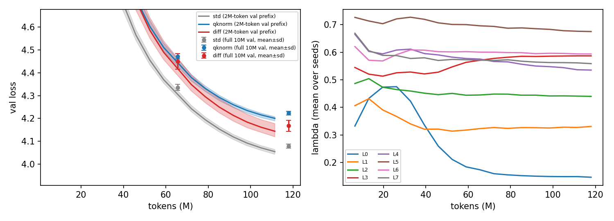

# diffattn — Differential Attention vs a QK-norm baseline, matched and multi-seed

Does Differential Attention (Ye et al., 2024, "Differential Transformer") still beat a standard GPT
once the baseline uses QK-norm? Three matched arms trained on FineWeb-Edu with identical data order,
optimizer, schedule, batch and token budget:

| arm      | attention                                                                 |
|----------|---------------------------------------------------------------------------|
| `std`    | standard causal MHA, RoPE                                                 |
| `qknorm` | same + RMSNorm on q and k per head                                        |
| `diff`   | Differential Attention per the paper (lambda reparam + init schedule, per-head RMSNorm, (1-lambda_init) scale), half the heads so matmul shapes match exactly |

Protocol: 3-LR sweep per arm at a short budget, best LR per arm, then 5 seeds per arm at full budget
(seed changes init and data order; same seed = same batches in every arm). Primary metric = final
held-out val loss; tests = Welch t-test and paired-by-seed permutation test. Secondary = zero-shot
HellaSwag / ARC-Easy / PIQA / LAMBADA and an attention-noise (needle retrieval) probe.

Scale: ~50M-param GPT (d=512, 8 layers) on free Kaggle T4 GPUs — see `docs/decision-log.md` for
every deviation from the original 350M/10B-token design and why.

## Layout
- `model.py` — GPT with the three arms; DiffAttn core computes both softmax maps in one fused SDPA call.
- `train.py` — trainer (DDP-capable, bf16/fp16, resumable, JSONL logs with val loss, grad norm, lambda per layer, throughput, MFU).
- `evals.py` — zero-shot evals + attention-noise probe.
- `prep.py` — tokenization of FineWeb-Edu + eval sets.
- `kaggle_build.py` — packs the code into a Kaggle script kernel and a run plan (`plans/*.json`).
- `analysis/analyze.py` — pre-registered analysis (tables, tests, MDE, figures).
- `tests/` — unit tests (lambda=0 reduces to standard attention, match against a naive reference, shapes, param matching, gradcheck, causality) and a GPU kernel-parity check.

## Result (15 main runs, all finished; raw logs in `runs/`, analysis in `analysis/results.json`)

| arm | final val loss (5 seeds) | LR (from sweep) |
|---|---|---|
| std | **4.0787 ± 0.0096** | 1e-3 |
| qknorm | 4.2231 ± 0.0081 | 5e-4 |
| diff | 4.1677 ± 0.0242 | 1e-3 |

At 51M parameters / 118M tokens per run, the **standard baseline beat DiffAttn by 0.089** (95% CI
[0.059, 0.119], Welch p = 5e-4) and beat QK-norm by 0.144 (p = 9e-9); DiffAttn beat QK-norm by 0.055
(p = 0.005). With no DiffAttn gain, "how much does QK-norm recover" is undefined at this scale. DiffAttn
did show the paper's mechanism: 3.2x higher attention share on the answer span in a retrieval probe.
Main caveats: tiny scale and budget, and LRs tuned with one seed at 25% budget (QK-norm's 5e-4 sits on
the edge of its grid). Full write-up: `paper/paper.md`.

